<p align="center">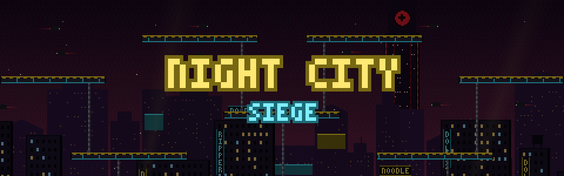</p>

<p align="center"><i>A neon pixel-art platform shooter, written from scratch in C.</i></p>

<p align="center">
  <a href="https://ttshadowtt.github.io/night-city-siege/"></a>
  <a href="https://github.com/TTShadowTT/night-city-siege/releases/latest"></a>
</p>

<p align="center">
  <a href="#install-on-windows"></a>
  <a href="#install-on-linux"></a>
  <a href="https://ttshadowtt.github.io/night-city-siege/"></a>
  <a href="#for-developers"></a>
  <a href="LICENSE"></a>
</p>

<p align="center">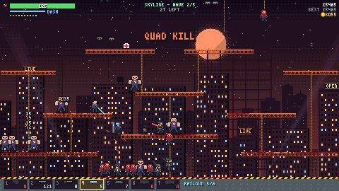</p>

<p align="center">
  <a href="#download">Download</a> ·
  <a href="#features">Features</a> ·
  <a href="#make-it-yours">Make it yours</a> ·
  <a href="#screenshots">Screenshots</a> ·
  <a href="#the-cast">The cast</a> ·
  <a href="#install-on-windows">Windows</a> ·
  <a href="#install-on-linux">Linux</a> ·
  <a href="#controls">Controls</a> ·
  <a href="#for-developers">For developers</a>
</p>

---

## Download

**[Download the latest release →](https://github.com/TTShadowTT/night-city-siege/releases/latest)**

| File | Platform | What it is |
|:--|:--|:--|
| [**Night-City-Siege-Setup.exe**](https://github.com/TTShadowTT/night-city-siege/releases/latest/download/Night-City-Siege-Setup.exe) | Windows | Installer with a Start-menu entry, desktop icon and uninstaller (1.5 MB) |
| [**Night-City-Siege.exe**](https://github.com/TTShadowTT/night-city-siege/releases/latest/download/Night-City-Siege.exe) | Windows | Portable: one file, nothing to install (1.1 MB) |

The browser version needs no download at all: **[play it right here](https://ttshadowtt.github.io/night-city-siege/)**.

The native Linux build is temporarily unavailable while it is rebuilt. Until it returns, Linux users can
[install the browser version as an app](#install-on-linux) or [build from source](#install-on-linux).

The native downloads are unsigned, so Windows SmartScreen may show "Windows protected your PC": click
**More info → Run anyway**. Every file above is built from the source in this repository.

## Features

- **15 districts**, from neon rooftops and a harbour to a forest, mountains and the moon
- **6 giant bosses**, one at the end of every district
- **7 weapons**: pistol, minigun, shotgun, railgun, grenades, rockets and a gravity gun
- Ropes to climb, dashes, combos and upgrade cards between waves
- **Campaign** and **Endless** mode, daily quests and achievements
- **22 player skins**, **11 enemy crews** (each with its own bodies), **40 pets**, 34 cursors
- 10 original synth soundtracks, plus **MY SONGS**: play your own music files
  (they stay on your computer and are never uploaded anywhere)
- Your own menu title in 42 styles, 45 UI styles
- Keyboard and mouse, or an Xbox / PlayStation controller

## Make it yours

Almost everything you see can be changed. All of it is in **OPTIONS** on the main menu (cursors and skins are
under **SKINS**), and your choices are saved with your progress.

<table>
<tr>
<td width="50%">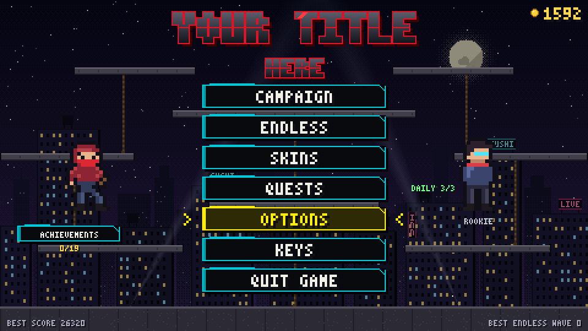</td>
<td>
<h3>Your own menu title</h3>
Replace <b>NIGHT CITY / SIEGE</b> with any two lines you like and pick one of <b>42 title styles</b>:
neon, chrome, fire, rainbow, gold, glitch, synthwave, ice and many more.
Unlocks once for 2500 coins.<br><br>
<i>OPTIONS → MENU TITLE</i>
</td>
</tr>
<tr>
<td width="50%">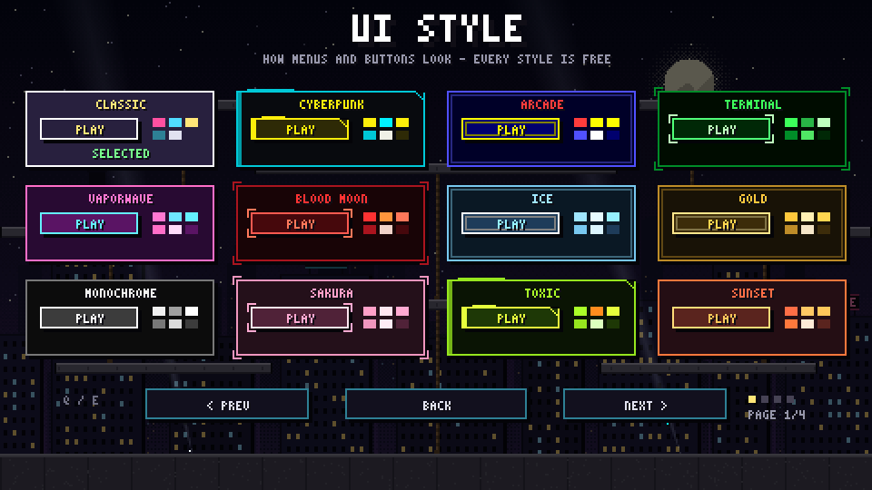</td>
<td>
<h3>UI styles</h3>
<b>45 looks</b> for every menu, button and frame: Cyberpunk, Arcade, Terminal, Vaporwave, Blood Moon, Sakura,
Halloween, one for every district, and a colour-blind friendly one. All free, switch any time.<br><br>
<i>OPTIONS → UI STYLE</i>
</td>
</tr>
<tr>
<td width="50%">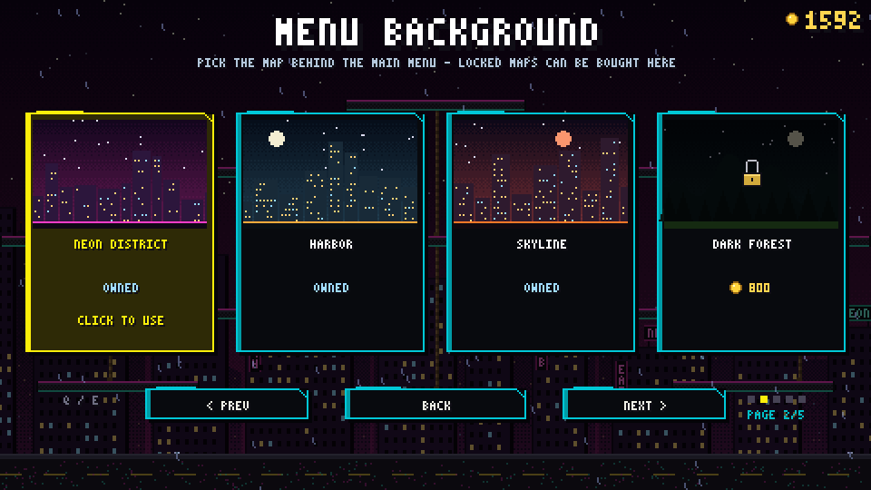</td>
<td>
<h3>Menu background</h3>
Choose the district that plays behind the main menu, keep the one you played last, or get a random one
every time. Locked districts can be bought right here.<br><br>
<i>OPTIONS → MENU BACKGROUND</i>
</td>
</tr>
<tr>
<td width="50%">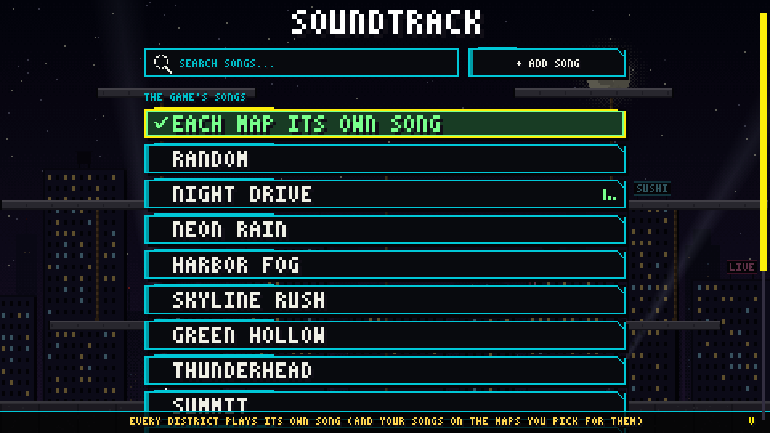</td>
<td>
<h3>Soundtrack and MY SONGS</h3>
10 original synth tracks, one for each kind of district. Let every map play its own, pick one for all of
them, or go random. With <b>+ ADD SONG</b> you add your own music files (MP3, FLAC, WAV, M4A...) and choose
which district each one plays on. They stay on your computer.<br><br>
<i>OPTIONS → SOUNDTRACK</i>
</td>
</tr>
<tr>
<td width="50%">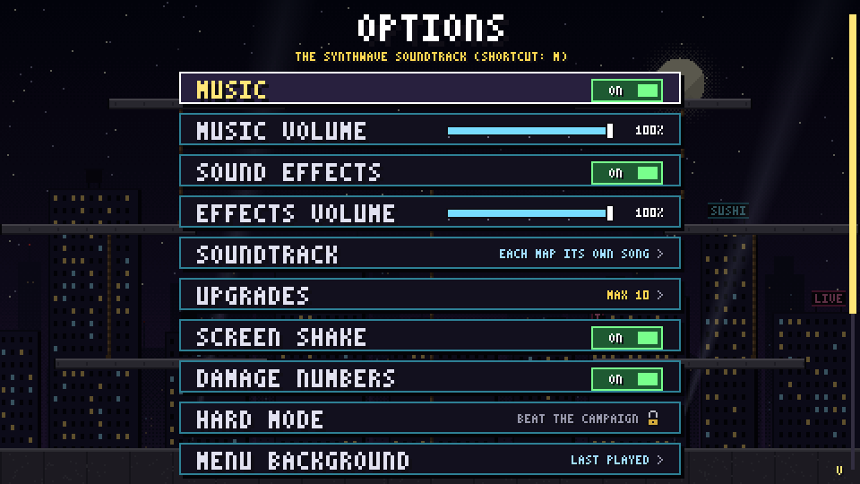</td>
<td>
<h3>Game settings</h3>
Music and sound effect volume, screen shake, damage numbers, how many upgrade cards you can take,
fullscreen and <b>hard mode</b> (tougher enemies, double coins) once you beat the campaign.<br><br>
<i>OPTIONS</i>
</td>
</tr>
</table>

<details>
<summary><b>All 42 title styles</b> (GIF)</summary>
<br>
<p align="center">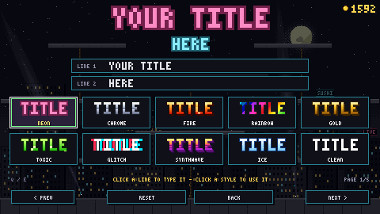</p>
<p align="center">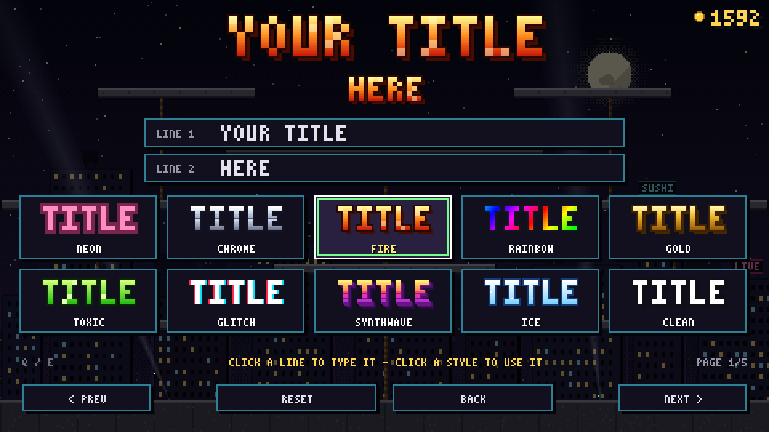</p>
</details>

<details>
<summary><b>All 45 UI styles</b> (GIF)</summary>
<br>
<p align="center">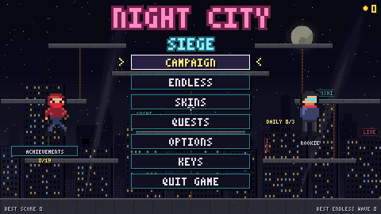</p>
</details>

<details>
<summary><b>All 34 cursors</b></summary>
<br>
<p align="center">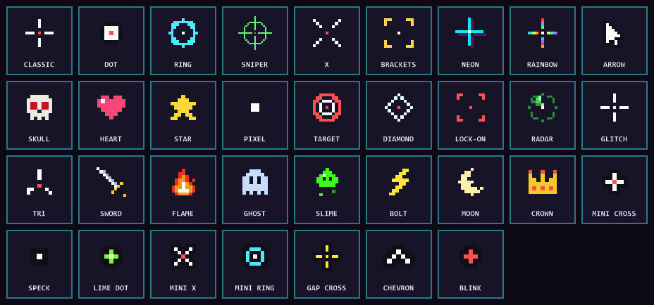</p>
</details>

## Screenshots

<details>
<summary><b>Boss fight</b> (GIF)</summary>
<br>
<p align="center">
  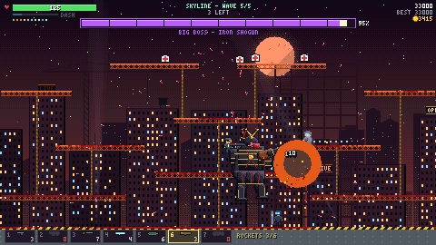<br>
  <i>Every district ends with a giant boss</i>
</p>
</details>

<details>
<summary><b>Menu, districts and skins</b> (6 screenshots)</summary>
<br>

| | |
|:--:|:--:|
| 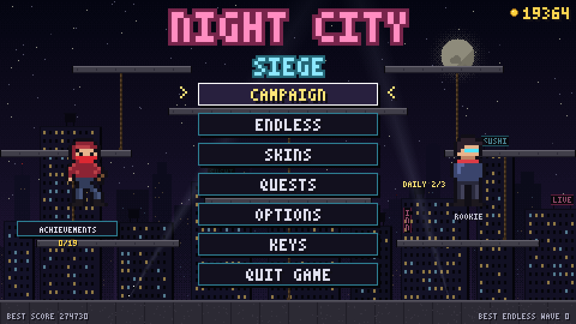 | 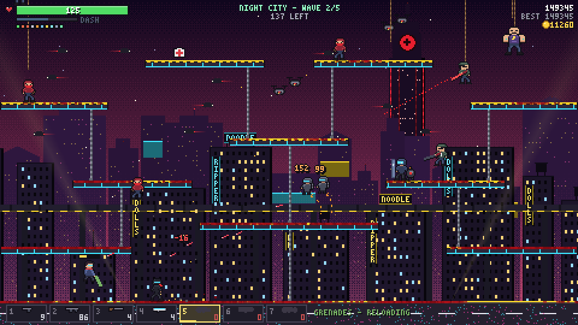 |
| Main menu | Night City |
| 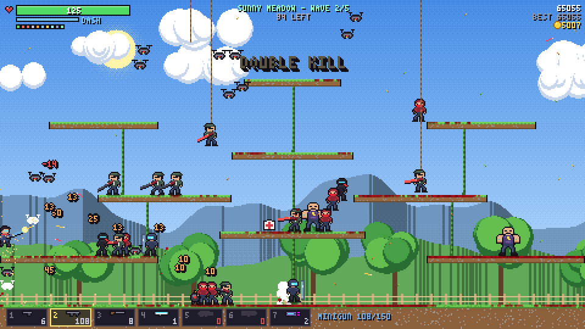 | 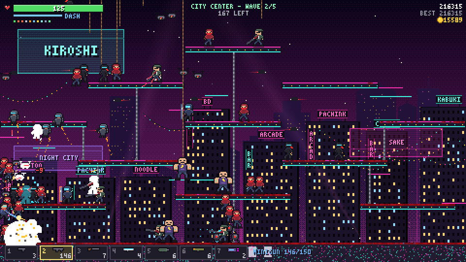 |
| Sunny Meadow | City Center |
| 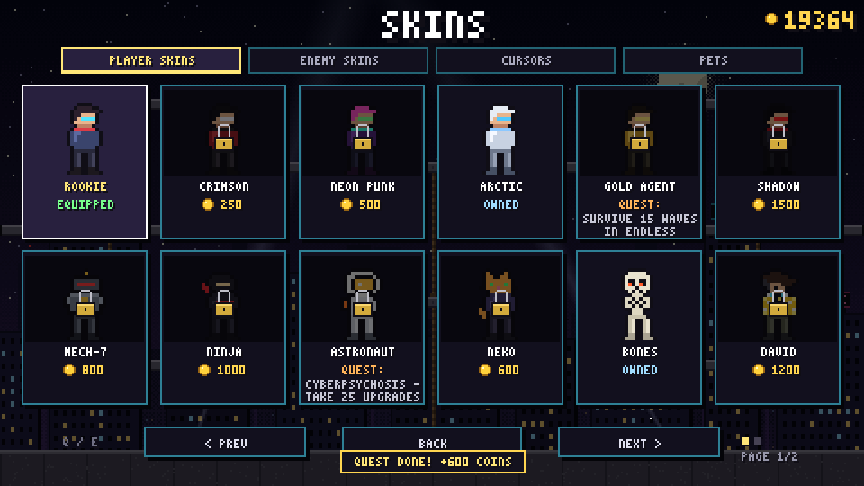 | 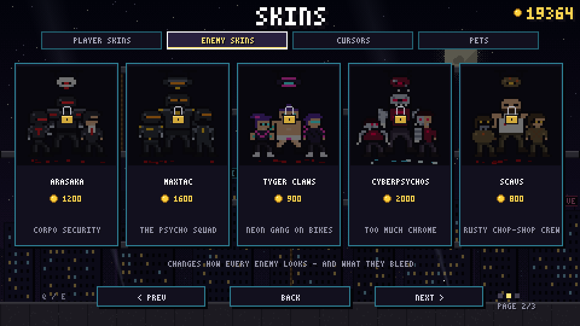 |
| Player skins | Enemy skins, each crew with its own bodies |

</details>

## The cast

<details>
<summary><b>Bosses</b> (6)</summary>
<br>
<p align="center">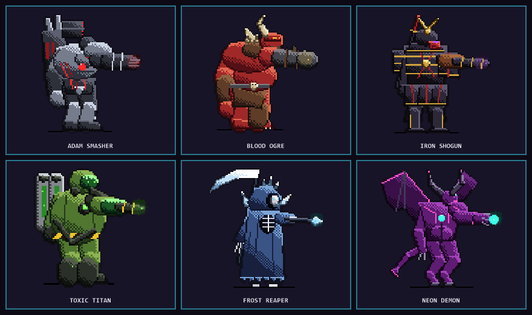</p>
</details>

<details>
<summary><b>Characters</b> (22)</summary>
<br>
<p align="center">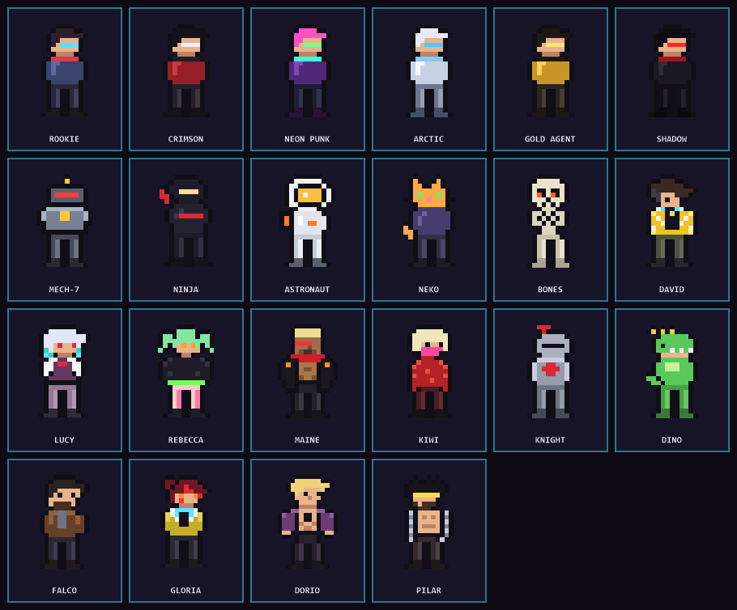</p>
</details>

<details>
<summary><b>Enemies</b> (9)</summary>
<br>
<p align="center">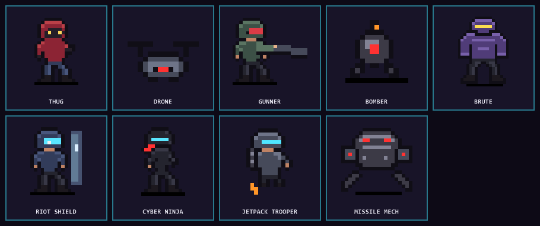</p>
</details>

<details>
<summary><b>Pets</b> (40)</summary>
<br>
<p align="center">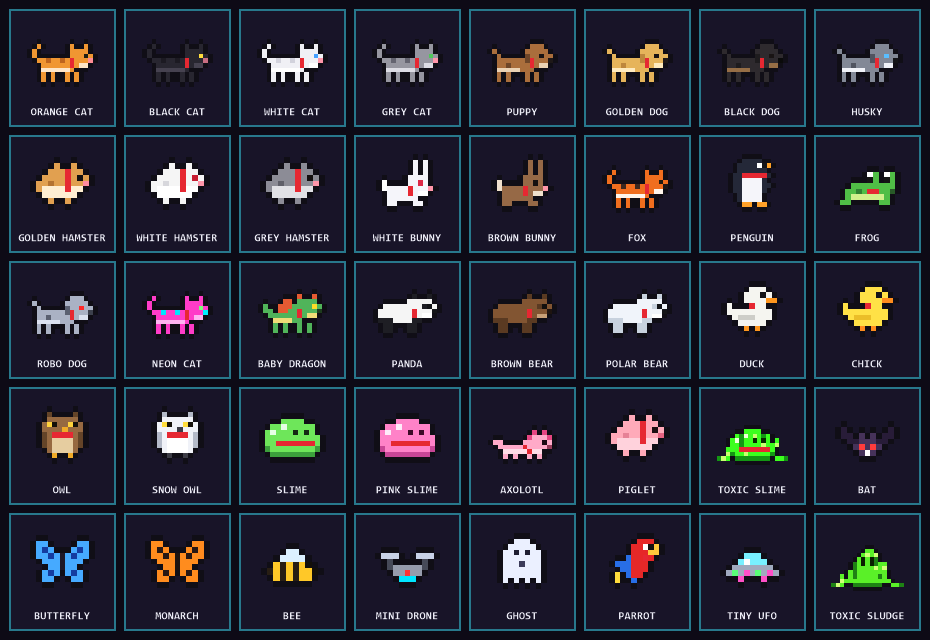</p>
</details>

<details>
<summary><b>Districts</b> (11 of 15)</summary>
<br>
<p align="center">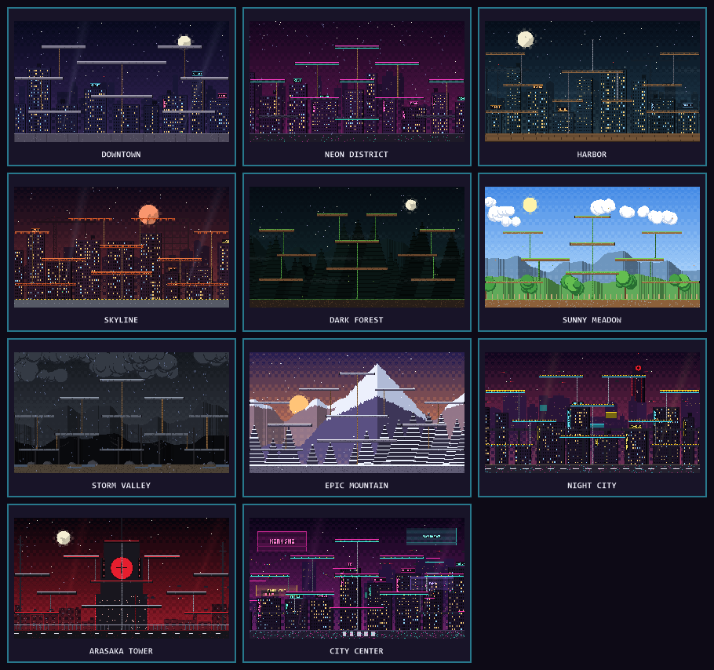</p>
<p align="center"><i>Plus four more districts to find in the campaign.</i></p>
</details>

---

## Install on Windows

### Option 1: install it as an app from the browser (easiest)

No download and no security warning. You get a desktop icon, its own window, and it works offline.

1. Open **<https://ttshadowtt.github.io/night-city-siege/>** in **Microsoft Edge** or **Google Chrome**.
2. Install it:
   - **Edge:** click the **App available / Install** icon at the right end of the address bar, or open
     the **...** menu and choose **Apps → Install this site as an app**.
   - **Chrome:** click the **Install** icon (a screen with an arrow) at the right end of the address bar, or open
     the **⋮** menu and choose **Cast, save and share → Install page as app**.
3. Click **Install**. Night City Siege now has a Start-menu entry, and you can pin it to the taskbar or desktop.

Your progress is saved in the browser automatically.
**Uninstall:** open the app, click the **...** menu at the top of its window and choose **Uninstall**.

### Option 2: download the Windows game

Grab **[Night-City-Siege-Setup.exe](https://github.com/TTShadowTT/night-city-siege/releases/latest/download/Night-City-Siege-Setup.exe)**
for a normal install (Start-menu entry, desktop icon, uninstaller), or
**[Night-City-Siege.exe](https://github.com/TTShadowTT/night-city-siege/releases/latest/download/Night-City-Siege.exe)**
if you just want one file to double-click. Both run without a browser and save your progress in
`%LOCALAPPDATA%\NeonEdge`.

The files are unsigned, so Windows may show "Windows protected your PC": click **More info → Run anyway**.

### Option 3: build the Windows game (.exe) yourself

The native version runs without a browser. You can also compile it yourself in a few minutes:

1. Install **Git** and the **MinGW-w64** compiler. In a terminal (PowerShell):
   ```powershell
   winget install Git.Git
   winget install BrechtSanders.WinLibs.POSIX.UCRT
   ```
   Close and reopen the terminal afterwards so it finds `gcc`.
2. Download the code:
   ```powershell
   git clone https://github.com/TTShadowTT/night-city-siege.git
   cd night-city-siege
   ```
3. Build it (two commands, in the same folder):
   ```powershell
   windres src/platform/win32/game.rc -O coff -o game_res.o
   gcc -O2 -Isrc -Isrc/core -Isrc/platform/win32 -o "Night City Siege.exe" (Get-ChildItem src/core/*.c, src/platform/win32/*.c) game_res.o -mwindows -lgdi32 -lwinmm -lcomdlg32 -lole32 -lshell32 -lmfplat -lmfreadwrite -lmfuuid -lwindowscodecs -luuid
   ```
4. `Night City Siege.exe` is now in the folder. Double-click it to play,
   or right-click it and choose **Send to → Desktop (create shortcut)**.

Your progress and songs are saved in `%LOCALAPPDATA%\NeonEdge`. To uninstall, delete the folder you cloned
(and that one, if you also want to remove your save).

## Install on Linux

### Option 1: install it as an app from the browser (easiest)

1. Open **<https://ttshadowtt.github.io/night-city-siege/>** in **Chrome**, **Chromium**, **Edge** or **Brave**.
2. Click the **Install** icon at the right end of the address bar (or the browser menu → **Install page as app**).
3. It shows up in your app menu like any other program.

Firefox can play the game too, but it can't install it as an app.

### Option 2: build it from source

A small native program (X11, works on Wayland desktops through XWayland), about 20 MB of RAM. You build it from
the source in about a minute:

1. Install a compiler, the X11 headers and git:
   ```bash
   sudo apt install git build-essential libx11-dev libxext-dev   # Debian, Ubuntu, Mint, Pop!_OS
   sudo dnf install git gcc glibc-devel libX11-devel libXext-devel   # Fedora
   sudo pacman -S git base-devel libx11 libxext   # Arch, Manjaro
   ```
   On Debian and Ubuntu you can skip the two X11 packages: the script then downloads the headers into
   `~/.cache` by itself, without root.
2. Download the code and build and install it:
   ```bash
   git clone https://github.com/TTShadowTT/night-city-siege.git
   cd night-city-siege
   sh scripts/linux_from_source.sh
   ```
3. Start **Night City Siege** from your app menu or the desktop icon, or type `neon-edge` in a terminal.

- **Sound** goes through PulseAudio or PipeWire.
- **MY SONGS** (your own music) needs `ffmpeg` and `zenity` (or `kdialog` on KDE): `sudo apt install ffmpeg zenity`.
- **Controllers** work through the kernel's joystick driver (Xbox and PlayStation pads).
- **Your save** is kept in `~/.local/share/NeonEdge`, also when you update or uninstall.
- **Uninstall:** `~/Games/NeonEdge/uninstall.sh`
- **Update:** `git pull` in the folder, then run `sh scripts/linux_from_source.sh` again.

> The browser version and the native versions keep separate saves.

---

## Controls

| Keyboard and mouse | Controller | Action |
|:--|:--|:--|
| A D / ← → | Left stick / D-pad | Move |
| W S / ↑ ↓ | Left stick / D-pad | Climb ropes |
| Space | A | Jump |
| Shift | B / LT | Dash |
| Mouse (click to shoot) | Right stick to aim, RT to shoot | Aim and shoot |
| 1–7 / Q E / mouse wheel | LB / RB / Y | Switch weapon |
| R | X | Reload |
| Esc / P | Start / Back | Pause |
| F / F11 | | Fullscreen |
| M | | Music on / off |

The **KEYS** screen in the main menu shows every key and controller button.

---

## For developers

<details>
<summary><b>How the code is organised</b></summary>
<br>

Everything is plain C with no libraries. One game core runs everywhere; a thin platform layer per system
shows its pixels, plays its sounds and passes it the input.

| Folder | What's inside |
|:--|:--|
| [`src/core`](src/core) | the game itself: pure C, no OS calls, about 40 small modules |
| [`src/platform`](src/platform) | one thin layer per system: Windows, Linux, the browser |
| [`scripts`](scripts) | `linux_from_source.sh`, the Linux build and install |
| [`docs`](docs) | the playable website (GitHub Pages) |
| [`assets`](assets) | the game icon |
| [`media`](media) | the banner, screenshots and GIFs on this page |

In detail:

```
src/
  game.h              the only contract between the core and a platform (480x270 pixels, sounds, input)
  core/               the game itself: pure C, no OS calls, split into modules
    core.h            includes every module header, in dependency order
    base_*            constants, random numbers, colours, drawing, the pixel font, sprites
    audio_*           synthesised sound effects and soundtracks
    world_*           the districts: data, scenery, parallax layers, collision
    gameplay_*        state, progression, saving, daily quests, spawning, combat, enemy AI, the player
    render_*          weather, bosses, entities, HUD, cursors, pets
    ui_*              menu styles, title styles, layout, button actions, widgets, screens, the frame
    api.c             the entry points a platform calls (game_init, game_tick, game_key, ...)
  platform/
    win32/            the native Windows exe (Win32 + GDI + waveOut + Media Foundation)
    linux/            the native Linux game (X11 + MIT-SHM + PulseAudio), its launcher and install scripts
    web/              the browser layer (slop_web.js), which runs the game compiled to WebAssembly
scripts/              the Linux build and install
assets/icons/         the game icon
media/                the banner, screenshots and GIFs in this README
docs/                 the GitHub Pages site (the browser build, installable as an app)
```

Each module keeps its helpers `static`; whatever other modules use is declared in its header.
Tables whose size other modules need (`PET_COUNT`, `UI_HAND_N`, ...) are checked with `_Static_assert`
next to the table, so adding an entry without updating the count fails the build with a clear message.

</details>

## License

MIT, see [LICENSE](LICENSE).
